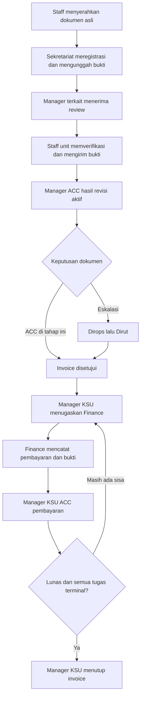
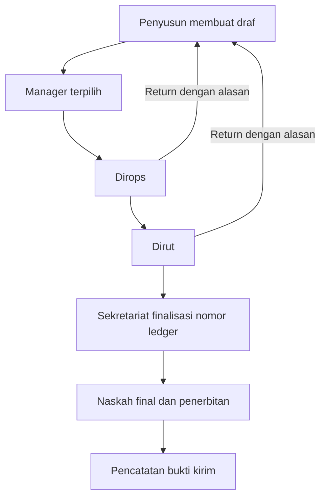

# Alur SIAP ARU V11

Baris baru yang dibuat saat `SIAP_V11_ENABLED=1` memiliki catatan V11. Surat dan tugas historis tetap menggunakan aturan tahap lamanya. Tugas baru mengikuti routing V11 ketika fitur aktif. Aturan dokumen yang sudah dicatat sebagai V11 tetap berlaku setelah flag dimatikan.

## Invoice masuk

Jika reviewer mengembalikan Surat Masuk, dokumen kembali ke antrean Sekretariat. Perubahan material seperti total, vendor, perihal, isi ringkas, SPK, unit pemohon, Manager atau berkas asli menaikkan revisi. Verifikasi lama tetap tersimpan. Setelah revisi masuk ke Manager, verifikasi untuk revisi tersebut harus di-ACC sebelum persetujuan atau eskalasi. Bukti pembayaran disimpan di tugas privat. Satu tugas bayar mencatat satu pembayaran. ACC Manager memperbarui buku utang yang sama.

## Surat Keluar dan tugas

Hubungan tugas asal mengikuti `parent_id`. Dirut dapat menugaskan Dirops atau Manager. Dirops meneruskan ke Manager. Manager menugaskan Staff/PIC atau Finance sesuai kewenangan. Hasil kembali ke pemberi tiap tugas. Tugas induk dapat diajukan setelah seluruh tugas anak selesai, dikembalikan sebagai tugas utuh, atau dibatalkan secara sah. Surat hasil harus terbit dan berasal dari tugas yang sama atau dari hasil akhir anak yang benar-benar telah di-ACC. Penerbitan dan ACC hasil tetap tindakan terpisah.

## Hak akses

| Role | Kewenangan V11 |
|---|---|
| Staff/PIC | Serahkan surat, ajukan Nota Dinas melalui Manager, susun Surat Keluar, kerjakan tugas unit yang diterima dan kirim bukti. PIC memakai role STAFF dan unit yang ditetapkan. |
| Sekretariat | Verifikasi administratif, catat tanggal/jam WIB dan bukti penerimaan, pilih Manager, finalisasi nomor dan naskah, lalu catat pengiriman. |
| Manager Operasional | Review dokumen unit Operasional, instruksikan verifikasi kepada unit terkait, nilai hasil dan delegasikan sesuai lingkup. |
| Manager Keuangan, SDM & Umum (KSU) | Review Keuangan/SDM/Umum, menugaskan Finance setelah invoice disetujui, ACC pembayaran dan closing. |
| Dirops/Dirut | Keputusan dan delegasi berjenjang sesuai tahap dan pemilik review. |
| Finance | Terima tugas bayar, catat transaksi yang telah dilakukan, lampirkan bukti. Buku utang terhubung hanya berubah saat ACC. |
| Root Admin | Akses administrasi, audit dan jalur penanganan umum. Tugas verifikasi dan pembayaran memerlukan peserta yang ditetapkan. |

## Status dan syarat

| Objek | Transisi utama |
|---|---|
| Surat Masuk | `SECRETARIAT_INTAKE → MANAGER_REVIEW → APPROVED` atau melalui `DIRECTOR_OPS_REVIEW → PRESIDENT_DIRECTOR_REVIEW`. Review dapat memberi tugas tanpa memindahkan status. |
| Bukti terima | Jam, metode, pengantar, penerima, tanggal, dokumen asli dan file bukti tervalidasi sebelum registrasi. |
| Invoice Masuk | Dokumen `APPROVED` terpisah dari buku utang `OPEN → PARTIAL → PAID`. `COMPLETE` mensyaratkan verifikasi terbaru, lunas dan semua tugas terminal. |
| Disposisi | `UNSEEN → SEEN/IN_PROGRESS → REVIEW_* → COMPLETED`. Return hasil kembali ke `IN_PROGRESS`. `RETURNED` dan `CANCELLED` menutup tugas dengan alasan. |
| Nota Dinas | `DRAFT → MANAGER_REVIEW`. Pengusul Manager dapat memilih Dirops atau Dirut. Pengajuan Persekot perlu SPB PDF pada submit. Dokumen checklist lain mengikuti SOP kasus. |
| Surat Keluar | `DRAFT → MANAGER_REVIEW → DIRECTOR_OPS_REVIEW → PRESIDENT_DIRECTOR_REVIEW → READY_TO_ISSUE → WAITING_SIGNATURE → ISSUED`. Tanggal, penerima, kanal dan bukti kirim dicatat setelah terbit. Nomor historis tetap di ledger. |

Unit Operasional diarahkan ke Manager Operasional. Keuangan, SDM dan Umum diarahkan ke Manager KSU. Unit IT, Pengadaan, Legal dan PIC memerlukan pilihan Manager secara eksplisit. Staff untuk verifikasi harus punya unit yang sesuai. Manager Gedung tetap tersedia untuk riwayat dan sesi lama yang berhak.

Invoice yang sudah mempunyai nomor di buku utang tidak dibuat ulang otomatis. Nomor invoice buku utang tetap mengikuti indeks unik existing. Lakukan rekonsiliasi untuk tagihan lama atau benturan nomor antarvendor. Identitas invoice baru memakai pasangan vendor dan nomor. Dokumen yang ditolak final tetap memiliki jejak dan identitas aslinya.

## Notifikasi dan status verifikasi

Notifikasi di aplikasi mengikuti penerima review surat, disposisi baru, pengembalian hasil dan hasil yang disetujui. Persetujuan invoice memberi tahu Manager KSU untuk menyiapkan instruksi Finance. Event notifikasi disimpan bersama audit dalam transaksi perubahan workflow. Daftar dan penanda baca tersedia untuk penerima dengan pemeriksaan akses dokumen pada setiap permintaan.

Header aplikasi memperbarui jumlah notifikasi setiap 15 detik saat halaman aktif. Klik notifikasi membuka dokumen atau tugas dan mencatat waktu baca. Histori surat dan disposisi menyimpan rincian transisi.

Bagian verifikasi invoice menampilkan **Menunggu Verifikasi**, **Disetujui**, atau **Ditolak**. Persetujuan hasil unit berlaku untuk revisi aktif. Penolakan final pada dokumen menampilkan Ditolak. Pembayaran dapat diproses setelah persetujuan dokumen dan instruksi Manager KSU kepada Finance.

## Persyaratan sebelum Finance

Dari detail Invoice Masuk V11, Pengajuan Persekot, atau Pengajuan Pembayaran Nonpersekot, buka **Persyaratan sebelum Finance**. Penyusun, pihak yang berwenang di jalur review, atau Staff yang sedang mengerjakan disposisi bisa memilih kategori dan mengunggah berkas PDF, JPG, atau PNG. Sistem memeriksa tipe berkas dan mencatat pengunggah di audit. Dokumen lama yang hanya dicentang perlu dilengkapi lewat panel ini.

| Persyaratan | Persekot | Nonpersekot dan Invoice Masuk |
| --- | --- | --- |
| BPK Pengajuan | Wajib | Wajib |
| SPB dalam PDF | Wajib sejak pengajuan | Dikecualikan |
| Nota Dinas ke Keuangan/Direksi | Wajib | Wajib |
| Kontrak Perjanjian | Wajib | Wajib |
| SPK | Wajib | Wajib, rujukan SPK invoice yang masih berlaku dan memiliki berkas dapat dihitung |
| Perhitungan Margin | Wajib | Wajib |
| Surat Pesanan | Wajib | Wajib |
| Surat Informasi Pembayaran / Rekening Penerima | Wajib bila ke vendor | Wajib bila ke vendor |

Tentukan apakah pembayaran ditujukan kepada vendor atau selain vendor. Invoice Masuk menggunakan vendor sebagai nilai awal. Jika invoice dicatat tanpa rujukan SPK, unggah berkas SPK pada kategorinya sebelum instruksi bayar. Nota Dinas biasa tetap tersedia untuk surat internal di luar pengajuan pembayaran.

Manager KSU membuat disposisi pembayaran setelah pengajuan disetujui dan semua persyaratan terisi. Finance mengunggah bukti hasil pembayaran. Manager KSU memeriksa dan meng-ACC hasil. Untuk Invoice Masuk, verifikasi unit tetap wajib dan pencatatan terhubung ke buku utang. Untuk Nota Dinas, instruksi dan bukti tercatat di disposisi pembayaran pengajuan.

### Penerapan

Terapkan `database/migrations/2026-11-18-v11-payment-documents.sql` setelah migrasi V11 yang sudah terpasang dan sebelum memulai build baru di produksi. Migrasi menambah dua tabel, mempertahankan SPB lama, dan tidak mengubah data historis. Pengajuan V11 yang masih berjalan perlu mengisi persyaratan yang kurang sebelum masuk atau meneruskan proses Finance. Alur dokumen historis di luar V11 mengikuti aturan awalnya.
